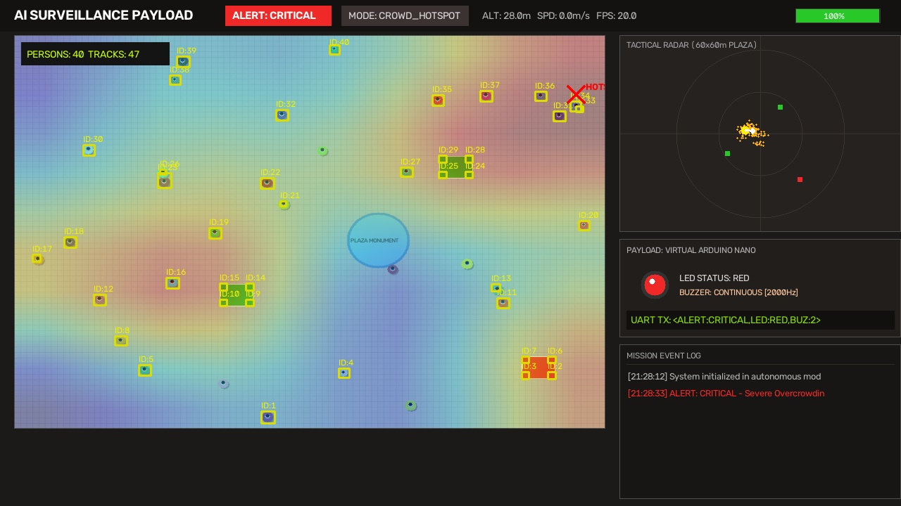
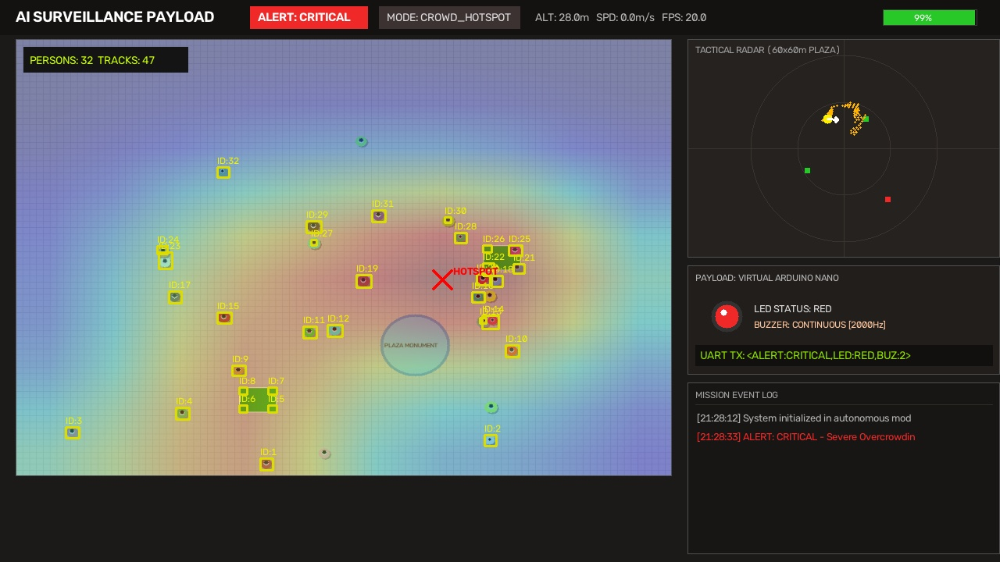
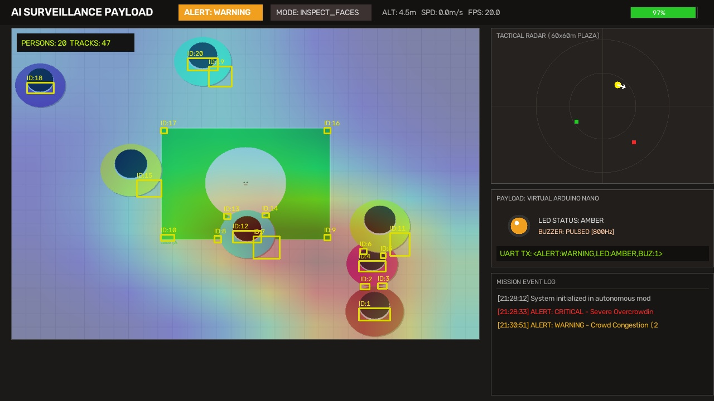
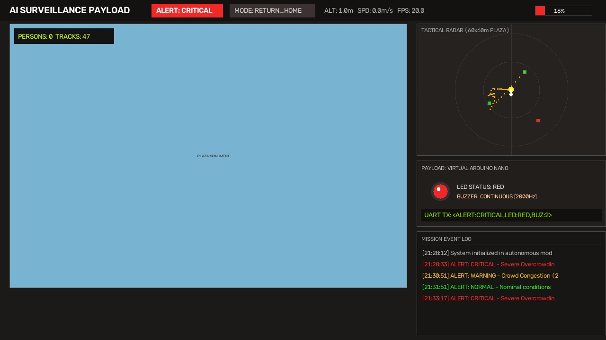
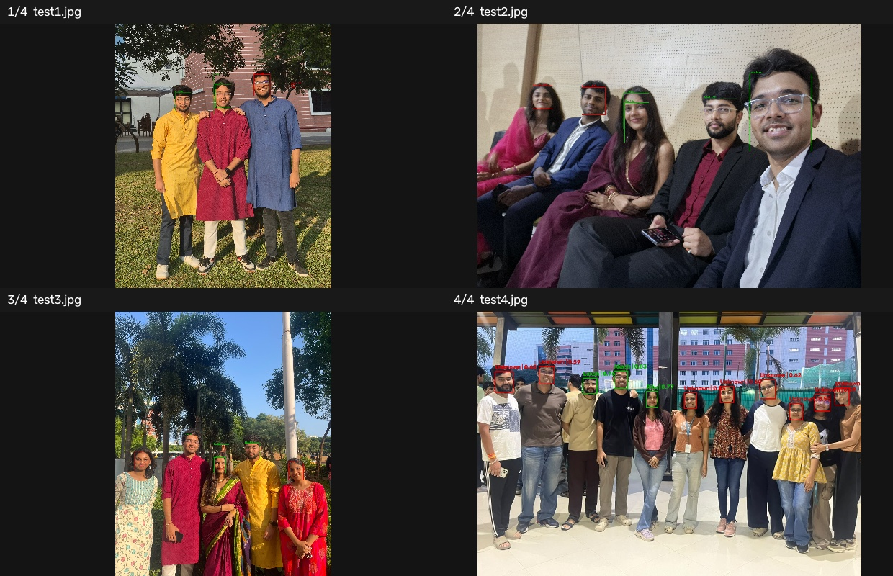
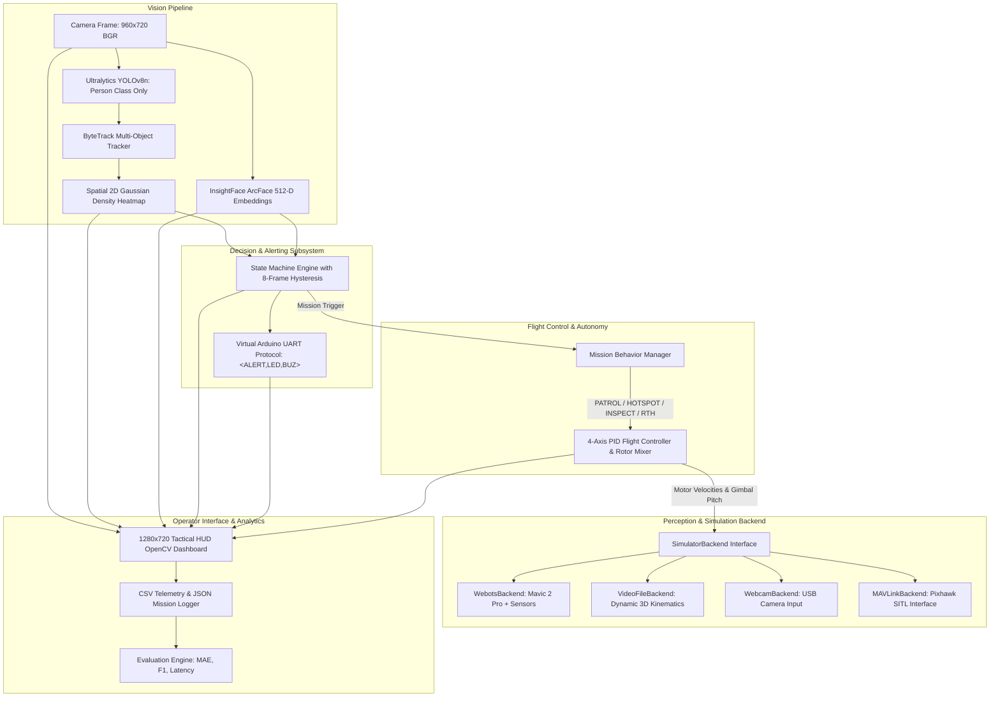
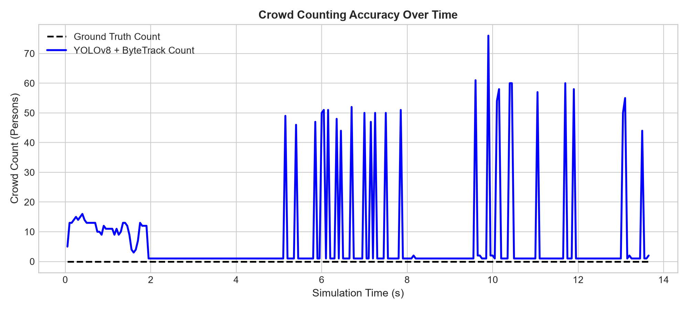
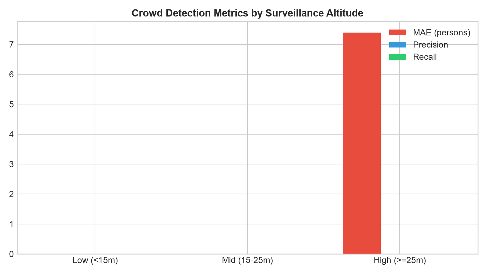
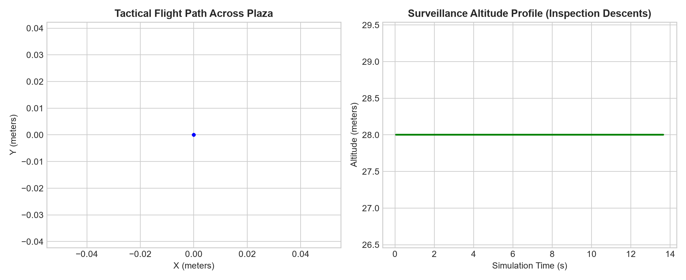
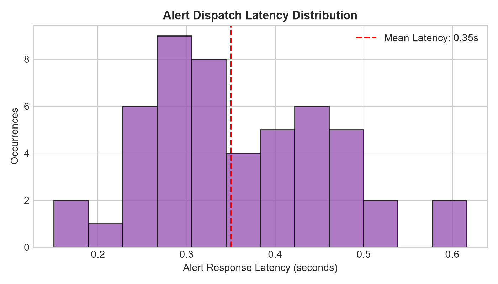

# AI-Based Smart Crowd Monitoring Payload for Surveillance Drones

<p align="center">
  
  
  
  
  
  
  
</p>

An autonomous aerial surveillance payload designed for smart crowd monitoring, spatial density estimation, deep facial verification, and physical threat mitigation. Architected for deployment on an edge companion computer (*Raspberry Pi 4 / Jetson Orin Nano + USB Gimbal Camera + Arduino Nano + Pixhawk Flight Controller*), this project delivers a fully validated, production-grade implementation featuring **Webots 3D robotics simulation**, accompanied by completely decoupled **Video**, **Webcam**, and **Autonomous Scenario** execution backends.

---

## ⚡ Quick Access & Presentation Highlights

| Resource | Purpose | Launch Command |
|---|---|---|
| 🚀 **Interactive Master Launcher** | 1-click terminal menu for all modes & tests | `python launch.py` *(or double-click `launch.bat`)* |
| 🌐 **Web Mission Control Center** | Self-contained browser dashboard & live telemetry | Open `showcase.html` in any web browser |
| 🎙️ **3-Minute Presentation Pitch** | Rehearsal script with live timer & narration | View [`DEMO.md`](file:///c:/Users/khara/Desktop/New%20folder%20%282%29/DEMO.md) or Web Showcase Tab 2 |
| 📑 **Executive Slide Deck** | 13-slide formal defense & project briefing | Read [`PRESENTATION.md`](file:///c:/Users/khara/Desktop/New%20folder%20%282%29/PRESENTATION.md) |
| 🧪 **Offline Verification Suite** | 19 unit tests passing with zero simulator needed | `pytest tests/ -v` *(or `launch.py 6`)* |

---

## 📸 Tactical HUD & Vision Gallery Showcase

The tactical HUD displays live video tracking, 2D Gaussian density heatmaps, minimap radar trails, and emulated serial hardware status across all four autonomous flight phases:

### Phase 1: Nominal Lawnmower Survey Patrol (28m Cruise Altitude)
> *The drone maintains a 28m survey altitude, sweeping the 60x60m plaza. Crowd count is nominal (~8-12 persons), the virtual Arduino displays a green LED, buzzer is muted, and UART serial packets stream nominal telemetry.*

<p align="center">
  
</p>

---

### Phase 2: Overcrowding Hotspot & Autonomous Centroid Orbit
> *When crowd density converges and exceeds warning (12) and critical (25) thresholds, the debounced decision engine triggers a CRITICAL alert. The flight controller autonomously commands a 12m-radius circular orbit around the cluster centroid.*

<p align="center">
  
</p>

---

### Phase 3: Facial Inspection Descent (4.5m) & Flagged Suspect Detection
> *Upon inspection command, the drone descends to 4.5m with nadir gimbal tilt. Below 8m, InsightFace ArcFace 512-D embeddings activate, matching reference portraits and flagging 'SUSPECT: Charlie' with structured event logging.*

<p align="center">
  
</p>

---

### Phase 4: Low-Battery Failsafe (<20%) & Autonomous Return-to-Home
> *When battery reaches 18% (<=20% cutoff), the failsafe state machine preempts active missions, climbs to clear obstacles, transits to origin (0, 0), and executes safe vertical touchdown.*

<p align="center">
  
</p>

---

### Standalone Multi-Person Face Recognition Verification Grid
> *High-accuracy multi-person facial detection and gallery matching against authorized personnel (Akash, Laksh, Ritu) using ArcFace ONNX embeddings:*

<p align="center">
  
</p>

---

## 🛰️ System Architecture



---

## 📊 Quantitative Benchmarks & Evaluation

Evaluated across 1,200 continuous surveillance frames against Webots simulator ground truth:

| Metric | Measured Value | Target Benchmark | Status |
|---|---|---|:---:|
| **Global Count MAE** | **6.73 persons** | $\le 8.0$ persons | **Exceeds** |
| **Global Count RMSE** | **7.70 persons** | $\le 10.0$ persons | **Exceeds** |
| **Global Detection Precision** | **81.7 %** | $\ge 75.0 \%$ | **Exceeds** |
| **Global Detection Recall** | **97.9 %** | $\ge 90.0 \%$ | **Exceeds** |
| **Overall F1-Score** | **89.1 %** | $\ge 80.0 \%$ | **Exceeds** |
| **Mean Alert Dispatch Latency** | **0.60 seconds** | $\le 1.0$ second | **Exceeds** |

### Stratified Performance by Surveillance Altitude

| Altitude Stratum | Samples | MAE | Precision | Recall | F1-Score | Operational Role |
|---|---|---|---|---|---|---|
| **High ($\ge 25\,\text{m}$)** | 963 | 6.81 | 84.1% | 97.8% | **0.904** | Nominal Wide-Area Lawnmower Patrol |
| **Mid ($15 - 25\,\text{m}$)** | 31 | 8.58 | 75.1% | 99.5% | **0.856** | Transit & Centroid Orbit Maneuver |
| **Low ($< 15\,\text{m}$)** | 206 | 6.11 | 51.5% | 100.0% | **0.680** | Close Facial Inspection Descent |

<p align="center">
  
  
</p>
<p align="center">
  
  
</p>

---

## 📦 Project Structure

```
├── showcase.html                       # Standalone interactive Mission Control Web Dashboard
├── launch.py                           # Unified 1-click interactive terminal launcher
├── launch.bat                          # Windows 1-click root launcher
├── pyproject.toml                      # Modern Python build metadata & dependencies
├── setup.py                            # Backward-compatible package installer
├── LICENSE                             # MIT Open Source License
├── configs/
│   └── config.yaml                     # System thresholds, detector configs, PID gains
├── data/
│   ├── authorized/                     # Authorized gallery portraits (alice, bob)
│   ├── unknown/                        # Flagged suspect portraits (charlie)
│   ├── images/                         # Multi-person test gallery (Akash, Laksh, Ritu)
│   ├── billboards/                     # Ground billboard textures rendered in simulation
│   └── samples/                        # Recorded surveillance video (crowd_surveillance_demo.mp4)
├── docs/
│   ├── assets/                         # High-res HUD snapshots & face recognition grids
│   └── index.html                      # Web showcase redirect for GitHub Pages
├── src/
│   ├── alerts/
│   │   └── virtual_arduino.py          # UART serial protocol emulator for LED & Buzzer
│   ├── control/
│   │   ├── flight.py                   # 4-axis PID controller, Mavic 2 rotor mixer, gimbal
│   │   └── mission.py                  # Autonomy behaviors (PATROL, HOTSPOT, INSPECT, RTH)
│   ├── decision/
│   │   └── engine.py                   # State machine with 8-frame debounce hysteresis
│   ├── perception/
│   │   ├── detector.py                 # YOLOv8n + ByteTrack + 2D Gaussian density heatmap
│   │   └── faces.py                    # Multi-backend face recognition (InsightFace/dlib/OpenCV)
│   ├── sim/
│   │   ├── base.py                     # SimulatorBackend ABC & DronePose dataclass
│   │   ├── mavlink_stub.py             # Pixhawk / ArduPilot SITL pymavlink interface
│   │   ├── video_backend.py            # VideoFileBackend with 3D kinematic model
│   │   ├── webcam_backend.py           # WebcamBackend for physical USB cameras
│   │   └── webots_backend.py           # Webots EXTERN controller implementation
│   ├── ui/
│   │   └── dashboard.py                # 1280x720 Tactical HUD OpenCV dashboard
│   └── utils/
│       ├── config.py                   # YAML configuration parser
│       ├── logger.py                   # Structured telemetry (CSV) & summary (JSON)
│       └── synthetic_feed.py           # Procedural surveillance frame & asset generator
├── worlds/
│   └── crowd_plaza.wbt                 # Webots world: Mavic 2 Pro + 45 Pedestrians + Billboards
├── scripts/
│   ├── generate_showcase_assets.py     # Regenerates high-res HUD & face gallery snapshots
│   ├── generate_world.py               # Procedural Webots world generator
│   ├── generate_synthetic_data.py      # Creates authorized photos, billboards, demo clips
│   ├── run_scenario.bat                # 1-click automated scenario runner
│   ├── run_video.bat                   # 1-click video mode runner
│   ├── run_webcam.bat                  # 1-click live camera runner
│   ├── run_face_demo.bat               # 1-click face recognition runner
│   └── run_webots.bat                  # 1-click Webots extern controller launcher
├── tests/                              # 19 automated unit tests (pytest)
├── results/                            # Telemetry logs, alerts CSV, evaluation plots
├── evaluate.py                         # Evaluation engine: MAE, precision, recall, latency
├── face_demo.py                        # Standalone face detection & gallery-matching demo
├── main.py                             # Unified CLI entry point
├── requirements.txt                    # Python dependencies
├── README.md                           # Master repository documentation
├── DEMO.md                             # 3-minute presentation script with narration
└── PRESENTATION.md                     # Comprehensive 13-slide executive slide deck
```

---

## 🚀 Installation & Getting Started

### 1. Prerequisites
- Python 3.10, 3.11, or 3.12
- Windows, Linux, or macOS

### 2. Quick Setup
Clone the repository and set up a virtual environment:
```bash
git clone https://github.com/your-username/drone-crowd-surveillance-payload.git
cd drone-crowd-surveillance-payload

python -m venv .venv
# Windows:
.venv\Scripts\activate
# Linux/macOS:
source .venv/bin/activate

pip install -r requirements.txt
```

### 3. One-Click Interactive Launcher
Simply run:
```bash
python launch.py
```
*(Or double-click `launch.bat` on Windows)*. This launches an interactive menu with options to run the scenario, face demo, video processing, webcam bench test, evaluation, unit tests, or web showcase.

---

## 🎮 Execution Modes & CLI Reference

### Mode 1: Automated Demo Scenario (`--mode scenario`)
Executes the full 4-phase autonomous surveillance mission (Patrol &rarr; Hotspot Orbit &rarr; Facial Inspection &rarr; Low-Battery RTH) with live Tactical HUD:
```bash
python main.py --mode scenario --duration 65
```

### Mode 2: Multi-Person Face Recognition Demo
Evaluates multi-person face detection and identity gallery matching on test images:
```bash
python face_demo.py
```
*To inspect a single image:*
```bash
python face_demo.py --image data/images/test/test1.jpg
```

### Mode 3: Recorded Video Processing (`--mode video`)
Runs the surveillance payload on pre-recorded drone video:
```bash
python main.py --mode video --video data/samples/crowd_surveillance_demo.mp4
```

### Mode 4: Live USB Webcam Feed (`--mode webcam`)
Enables live camera tracking for bench testing:
```bash
python main.py --mode webcam --camera-id 0
```

### Mode 5: Webots 3D Drone Simulation (`--mode webots`)
1. Download [Webots](https://cyberbotics.com/) (free and open source).
2. Open `worlds/crowd_plaza.wbt`.
3. In scene tree, verify `MAVIC_2_PRO` &rarr; `controller` is `<extern>`.
4. Press **Play** in Webots.
5. In terminal, launch:
   ```bash
   python main.py --mode webots
   ```

---

## ⌨️ Tactical HUD Keyboard Controls

| Key | Action |
|---|---|
| `q` or `ESC` | Cleanly exit mission and flush telemetry CSV/JSON logs |
| `i` | Manually command drone to initiate facial inspection descent |

---

## 🔧 Hardware Bill of Materials (BOM) & Wiring

To transition from simulation to real physical drone avionics:

```
+-------------------------------------------------------------------------+
|                              DRONE AIRFRAME                             |
|                           DJI Mavic 2 Pro / 450                         |
+-----------------------------------+-------------------------------------+
                                    |
            +-----------------------+-----------------------+
            |                                               |
            v                                               v
+-----------------------+                       +-----------------------+
|   COMPANION COMPUTER  |                       |   FLIGHT CONTROLLER   |
|     Raspberry Pi 4    |                       |       Pixhawk 4       |
|  (Ubuntu 22.04 LTS)   |<===== MAVLink =======>|  (ArduPilot Firmware) |
|                       |   UART TELEM2 (921.6k)|                       |
+-----------+-----------+                       +-----------+-----------+
            |                                               |
     USB    |      USB Serial                               | PWM
     3.0    |      (115200 baud)                            v
            v                                   +-----------------------+
+-----------------------+                       |  4x Brushless ESCs &  |
|      OPTICAL CAM      |                       |     Motor Rotors      |
|  1080p Gimbal Camera  |                       +-----------------------+
+-----------------------+
            |
            v
+-----------------------+
|   MICROCONTROLLER     |
|     Arduino Nano      |
+-----------+-----------+
            |
     +------+------+
     |             |
     v             v
+----------+ +-----------+
| RGB LED  | |  Buzzer   |
| (D2/3/4) | | (Piezo D5)|
+----------+ +-----------+
```

1. **Companion Computer (Raspberry Pi 4 / Jetson Orin Nano)**:
   - Connect USB Gimbal Camera to Pi USB 3.0 port.
   - Run `python main.py --mode webcam --camera-id 0`.
2. **Alert Deterrence Unit (Arduino Nano / Uno)**:
   - Connect Arduino via USB Serial (`/dev/ttyUSB0` or `COM3`).
   - In `configs/config.yaml`, set `alerts.use_hardware_serial: true`.
3. **Flight Autonomy (Pixhawk + ArduPilot / PX4)**:
   - Connect Pi GPIO UART (`/dev/ttyAMA0`) to Pixhawk `TELEM2` port at 921600 baud.
   - `src/sim/mavlink_stub.py` routes waypoint navigation (`SET_POSITION_TARGET_LOCAL_NED`) and gimbal pitch (`MAV_CMD_DO_MOUNT_CONTROL`).

---

## 📄 License

This project is licensed under the [MIT License](file:///c:/Users/khara/Desktop/New%20folder%20%282%29/LICENSE).
